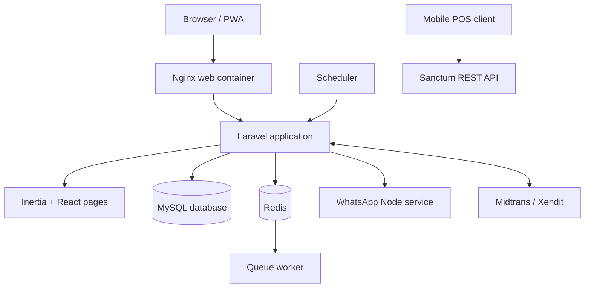

# Application Technical Overview

## 1. Purpose and Scope

Point of Sales is a web-based retail operations platform for stores, supermarkets, and businesses that sell products through one or more cashiers or warehouse locations.

The system covers the complete retail lifecycle:

```text
Purchase stock -> Receive goods -> Manage inventory -> Sell products
       -> Collect payments -> Manage customers -> Analyze performance
```

The application is more than a checkout screen. Its operational areas include:

- Point of sale and cashier shifts
- Products, categories, units, batches, and stock
- Multi-warehouse inventory and stock transfers
- Purchasing, goods receiving, supplier returns, and payables
- Customer receivables and payment collection
- Pricing rules, promotions, vouchers, and loyalty
- CRM segments, campaigns, reminders, and WhatsApp communication
- Dine-in areas, tables, public menus, and customer orders
- Reports, PDF documents, imports, and exports
- Users, roles, permissions, audit logs, and configuration

The application supports Indonesian tax workflows, including PPN/PPh configuration, and integrates with Midtrans, Xendit, thermal printers, and an optional WhatsApp Gateway.

## 2. High-Level Architecture

The system is a modular Laravel monolith with a React frontend and a small separate Node.js messaging service.



### Main layers

1. **Presentation layer**: Blade bootstrap pages, Inertia responses, React pages, layouts, forms, tables, charts, and PWA behavior.
2. **HTTP layer**: Web routes, API routes, controllers, request validation, authentication, authorization, and middleware.
3. **Application layer**: Services that implement pricing, tax, stock, purchasing, payments, CRM, loyalty, and audit rules.
4. **Domain and persistence layer**: Eloquent models, relationships, migrations, seeders, database transactions, and storage files.
5. **Runtime layer**: PHP-FPM, Nginx, MySQL, Redis, queue worker, scheduler, and the optional WhatsApp container.

## 3. Technology Stack

| Area | Technology |
| --- | --- |
| Backend | Laravel 13, PHP 8.3+ |
| Frontend | Inertia.js 3, React 19, Vite 5 |
| Styling | Tailwind CSS 3 |
| Authentication | Laravel Breeze for web, Laravel Sanctum for API tokens |
| Authorization | Spatie Laravel Permission |
| Primary database | MySQL 8.4 in Docker |
| Cache and queues | Redis 7.4 in Docker |
| Testing database | SQLite in-memory |
| Documents | Dompdf and PDF/receipt generation services |
| Data exchange | Laravel Excel import/export |
| Payments | Midtrans and Xendit |
| Messaging | Node.js, Express, whatsapp-web.js, Puppeteer |
| Browser features | Service worker, IndexedDB, camera barcode scanning, WebUSB thermal printing |

The main backend and frontend code live in the `point-of-sales` directory. The root Compose file runs the application as a group of cooperating containers.

## 4. Runtime Topology

The production Compose stack contains these services:

| Service | Responsibility |
| --- | --- |
| `app` | Laravel PHP-FPM runtime and application code |
| `web` | Nginx HTTP server and public asset delivery |
| `queue` | Redis-backed Laravel queue worker |
| `scheduler` | Laravel scheduled task worker |
| `database` | MySQL data store |
| `redis` | Cache, queue broker, and Redis persistence |
| `whatsapp` | Optional Node.js WhatsApp Gateway under the `whatsapp` profile |

Persistent Docker volumes store database data, Redis data, application files, framework files, logs, and WhatsApp authentication sessions. The web container exposes the application on port `8080` by default and provides a `/health` endpoint.

The development Compose override adds the Vite development server. Host development can also run Laravel and Vite directly.

## 5. Request and Response Flow

### 5.1 Web dashboard request

1. A browser requests a dashboard URL.
2. Laravel resolves the route in `routes/web.php`.
3. Authentication, session lifetime, locale, security headers, permissions, and module-specific middleware run.
4. The controller validates input and loads models or delegates business rules to a service.
5. The controller returns an Inertia response with page data and shared props.
6. Inertia resolves a React page under `resources/js/Pages/`.
7. The layout renders navigation, permissions, notifications, shift state, and the page content.

Shared Inertia props include the authenticated user, permissions, locale, notifications, active cashier shift, store profile, aging summaries, security state, and application version.

### 5.2 API request

1. A client calls `/api/v1/...` with a Sanctum bearer token.
2. The API authenticates the token and derives abilities from the user permissions.
3. The API controller validates the request and calls the same business services used by the web workflow where applicable.
4. The response is returned as JSON.

Login, registration, and payment webhook endpoints have their own authentication rules. Protected business endpoints require a bearer token.

## 6. Route and Middleware Architecture

Routes are divided by responsibility:

- `routes/web.php`: dashboard, POS, public pages, customer portal, documents, and webhooks exposed through web flows
- `routes/api.php`: versioned REST API and payment webhooks
- `routes/auth.php`: Breeze authentication flows
- `routes/console.php`: scheduled commands

Important middleware behavior:

| Middleware | Purpose |
| --- | --- |
| `auth` | Requires an authenticated web user |
| `permission` | Protects a route using a Spatie permission string |
| `active_shift` | Requires an open cashier shift for cart and checkout operations |
| `step_up` | Requires recent password confirmation for sensitive actions |
| `bot.guard` | Adds honeypot and timing checks to authentication forms |
| `registration.enabled` | Enables or disables public registration |
| `SecureHeaders` | Adds browser security response headers |
| `EnforceAbsoluteSessionLifetime` | Logs out sessions after the maximum lifetime |

Dashboard access is controlled at route and UI level. The backend remains authoritative; frontend permissions are used to hide or disable unavailable navigation and actions, but they are not a replacement for server-side authorization.

## 7. Backend Organization

### Controllers

- `app/Http/Controllers/Apps/`: dashboard and business modules
- `app/Http/Controllers/Api/`: REST API endpoints and webhooks
- `app/Http/Controllers/Reports/`: sales, profit, and insight reporting
- `app/Http/Controllers/Auth/`: login, registration, password, and verification flows
- `DocumentController.php`: PDF and document generation endpoints
- `PublicPortalController.php`: public invoice and receivable portal behavior

Controllers coordinate HTTP concerns. Business calculations and cross-module mutations are kept in services where possible.

### Services

| Service area | Main services |
| --- | --- |
| POS | `CashierShiftService`, `PricingService`, `TaxService`, `UnitConversionService`, `LoyaltyService` |
| Inventory | `StockMutationService`, `BatchService`, `StockTransferService`, `ReorderService` |
| Purchasing | `PurchaseOrderService`, `GoodsReceivingService`, `SupplierReturnService` |
| Finance | `ReceivableService`, `PayableAgingService`, `PaymentGatewayManager` |
| CRM | `CrmAutomationService`, `CustomerSegmentationService` |
| Documents and hardware | `ThermalPrintService`, PDF/export services |
| Governance | `AuditLogService` |
| External messaging | `WhatsAppService` |

The service layer is the main location for reusable business rules, audit events, stock effects, status transitions, and integration dispatch.

## 8. Core Data Model

The schema is implemented through migrations in `database/migrations/` and is represented by Eloquent models in `app/Models/`.

### Identity and access

- `users`
- Spatie `roles`, `permissions`, and role/permission pivot tables
- User preferences, verification state, and session-related security state

### Catalog and stock

- `products` and `categories`
- `units` and `product_units`
- `warehouses`
- `product_warehouse`, which stores warehouse-specific stock
- `product_batches` for batch and expiry tracking
- Composite product component relationships
- Stock mutations and stock opname records

### Sales

- `transactions`
- `transaction_details`
- `carts` and held carts
- `profits`
- `cashier_shifts`
- Sales returns and customer credits

### Procurement and finance

- `suppliers`
- `purchase_orders` and purchase order items
- `goods_receivings` and goods receiving items
- Supplier returns
- `payables` and payable payments
- `receivables` and receivable payments

### Pricing and customer engagement

- `customers`
- Member, tier, point, and loyalty history records
- `pricing_rules`, quantity breaks, bundle items, and buy/get items
- `price_lists` and price list items
- Customer vouchers
- Customer segments, campaigns, and reminders

### Dine-in and public ordering

- Dine-in areas and tables
- Dine-in orders and order items
- Public menus and customer order flows

### Governance and configuration

- Audit logs
- Store settings
- Payment settings
- Bank accounts
- Tax, printer, loyalty, and WhatsApp configuration

### Important relationships

- A transaction belongs to a cashier, shift, warehouse, and optional customer and bank account.
- A transaction has details, profit records, receivables, returns, campaign logs, and discount approval records.
- A product belongs to a category and is related to warehouses, units, batches, stock mutations, pricing, and returns.
- Purchase orders can produce goods receiving records, payable records, and stock increases.
- Customer segments connect customers to campaigns, vouchers, price lists, and loyalty behavior.
- Dine-in orders belong to tables and can later be associated with a completed transaction.
- Operational records retain user references where auditability is important.

## 9. POS Transaction Flow

The web POS controller and mobile POS API implement the same business concept through different transports.

1. A cashier opens a shift and selects or confirms a warehouse.
2. Products are searched by keyword, barcode, or camera scan.
3. The cart validates product availability for the active warehouse.
4. The cashier can change quantities or hold and resume the cart.
5. Checkout recalculates prices, promotions, loyalty, vouchers, taxes, discounts, and shipping on the server.
6. The application creates the transaction, details, and profit records inside a database transaction.
7. Warehouse stock is decremented and a stock mutation is recorded.
8. Pay-later sales create or update a receivable.
9. A payment gateway sale creates an external payment request and waits for a verified callback.
10. Discounts that exceed configured limits enter the approval workflow.
11. Receipt, invoice, and other documents can be generated after the transaction.

Stock changes are intended to be observable through stock mutation records and audit logs. In the current schema, both legacy product stock and warehouse pivot stock exist; multi-warehouse quantity should be treated as the `product_warehouse` value.

## 10. Inventory and Procurement Flow

### Stock movement

Stock can change through sales, goods receiving, sales returns, supplier returns, stock opname adjustments, and warehouse transfers. These changes should be represented in stock mutation history with the responsible user and operational context.

### Warehouse transfer

Transfers follow a source-to-destination lifecycle:

```text
Draft -> Sent -> Received
```

The source warehouse is reduced when the transfer is sent, and the destination warehouse is increased when it is received according to the transfer workflow.

### Purchasing

```text
Purchase Order -> Goods Receiving -> Stock increase + Payable
                                      -> Supplier return when needed
```

Reorder point logic can identify products that require replenishment and suggest draft purchase orders.

### Batch and expiry

Batch records support expiry tracking and FEFO-style allocation. Expiring products can be surfaced to operational users for action.

## 11. Finance, Pricing, and Customer Flows

### Receivables

Pay-later sales create receivables. Customers can make partial payments, while the system maintains balance, aging information, statements, and collection notes. The public customer portal can expose invoice and payment actions where configured.

### Payables

Goods receiving can create supplier payables. Payable payments and aging data support supplier obligation tracking.

### Pricing

The pricing engine supports:

- Base prices and customer-group price lists
- Quantity breaks
- Bundle promotions
- Buy-X-get-Y promotions
- Customer vouchers
- Loyalty point earning and redemption
- Discount approval thresholds

### Tax

Tax calculation supports configured PPN behavior, including exclusive and inclusive calculation modes. Tax settings also support business identifiers such as NPWP and NIB where configured.

## 12. Frontend Architecture

Frontend entry and shared behavior are defined in `resources/js/`.

### Layouts

- `DashboardLayout.jsx`: administrative dashboard navigation and shell
- `POSLayout.jsx`: cashier and checkout workspace
- `AuthenticatedLayout.jsx`: authenticated non-dashboard pages
- `GuestLayout.jsx`: authentication pages
- `PublicLayout.jsx`: public customer and ordering pages

### Page modules

React pages cover dashboard analytics, POS checkout, catalog, customers, suppliers, warehouses, purchasing, receiving, stock operations, finance, reports, CRM, dine-in, settings, access management, and public portal flows.

The frontend uses Ziggy route helpers, Tabler icons, Tailwind tokens, toast notifications, SweetAlert confirmation dialogs, and Chart.js reporting components.

### Offline and device features

- The service worker is registered from the public assets.
- IndexedDB stores cached product/customer data and pending transaction-related data.
- Camera scanning supports barcode workflows in compatible browsers.
- WebUSB supports compatible thermal printers.
- The application detects online status and can provide offline-friendly behavior.

The current repository clearly contains local storage and network fallback behavior. A complete automatic replay/synchronization worker should be verified before promising that every offline transaction is automatically synchronized in all failure cases.

## 13. Authentication and Security

### Web security

- Laravel Breeze handles web authentication.
- Email verification is supported.
- Login, registration, and password reset are throttled and protected by bot-guard checks.
- Sessions have an absolute lifetime, configured by the application.
- Sensitive administrative actions require recent password confirmation.

### Authorization

Spatie roles and permissions protect dashboard routes and actions. The `super-admin` role can bypass normal permission checks through the user authorization model.

### API security

Sanctum personal access tokens authenticate API clients. Token abilities are derived from user permissions, allowing mobile or third-party clients to receive scoped access.

### Browser and audit controls

Security response headers include content-type sniffing protection, frame protection, referrer policy, and a permissions policy. Audit logs capture important authentication, privileged, payment, stock, and configuration changes with before/after information where applicable.

## 14. API and External Integrations

### REST API

The API is versioned under `/api/v1` and is intended for mobile POS and third-party clients.

Available areas include:

- Authentication and current-user profile
- Products, categories, customers, warehouses, and suppliers
- POS shift lifecycle
- Product lookup and scanning
- Cart operations
- Hold and resume
- Checkout
- Transaction history

Interactive API documentation is exposed through the configured Scramble routes at `/docs/api` and `/docs/api.json`.

### Payment gateways

Midtrans and Xendit are selected through a payment gateway manager. Credentials are stored through the payment settings model and protected by encryption. Webhooks verify the provider-specific signature or callback token before updating internal payment state.

### WhatsApp Gateway

WhatsApp messaging is separated from Laravel:

```text
Laravel WhatsAppService <-> HTTP <-> Node.js Express service
                                      -> whatsapp-web.js
                                      -> Puppeteer / Chrome
                                      -> WhatsApp Web
```

The Node service maintains a persistent session volume and exposes connection, QR, messaging, and status behavior to Laravel. Campaign auto-send requires the feature to be enabled and a connected WhatsApp device.

### Other integrations

- Dompdf for invoices, receipts, labels, receivables, and payables
- Laravel Excel for product, customer, and transaction exchange
- WebUSB for supported thermal printers
- Barcode generation and camera scanning
- Indonesian administrative-region data
- Ziggy for frontend route generation

## 15. Queues, Scheduler, Cache, and Storage

Redis is used by the Docker runtime for cache and queue infrastructure. The queue container runs:

```bash
php artisan queue:work redis --sleep=3 --tries=3 --timeout=90 --max-time=3600
```

The scheduler container runs:

```bash
php artisan schedule:work
```

Known scheduled CRM tasks include:

- Daily customer segment synchronization at 01:00
- Daily reminder generation at 01:15

Application storage is used for product/public files, framework data, logs, and generated artifacts. `php artisan storage:link` exposes public storage through the `public/storage` symlink.

## 16. Development and Deployment

### Local development

```bash
composer install
npm install
php artisan key:generate
php artisan migrate --seed
php artisan storage:link

# Run in separate terminals
npm run dev
php artisan serve
```

For WhatsApp support, run the Node service separately:

```bash
cd whatsapp-service
npm install
npm start
```

### Docker development

```powershell
Copy-Item .env.example .env
docker compose -f compose.yaml -f compose.dev.yaml up -d --build
docker compose -f compose.yaml -f compose.dev.yaml exec app php artisan migrate --seed
docker compose -f compose.yaml -f compose.dev.yaml exec app php artisan storage:link
```

The application is then available at `http://localhost:8080` by default.

### Production concerns

- Set strong application, database, and service credentials.
- Use a public HTTPS `APP_URL` for payment callbacks.
- Run migrations and storage linking during release deployment.
- Run queue and scheduler workers continuously.
- Persist MySQL, Redis, application, log, and WhatsApp session volumes.
- Configure backups and health checks for the database and web service.
- Keep WhatsApp Chrome/Puppeteer dependencies available when that profile is enabled.

## 17. Testing and Quality

The test suite uses PHPUnit through Laravel and configures SQLite in-memory storage, array cache, synchronous queues, and isolated test sessions.

```bash
php artisan test
php artisan test --filter=TestName
vendor/bin/pint
npm run build
```

Feature coverage includes authentication, authorization, API behavior, POS transactions, pricing, loyalty, inventory, warehouses, stock opname, CRM, audit logs, cashier shifts, returns, reports, pagination, and profile management.

Tests should account for PPN behavior. Product fixtures that are not testing tax calculation should explicitly set `tax_rate=0` when appropriate.

## 18. Repository Map

```text
app/
  Console/                 Scheduled commands and console behavior
  Http/Controllers/        Web, API, auth, report, and portal controllers
  Http/Middleware/         Authentication, authorization, security, and context
  Models/                  Eloquent models and relationships
  Services/                Business rules and integration services
bootstrap/                 Application bootstrap and provider loading
config/                    Framework and application configuration
database/
  factories/               Model factories
  migrations/              Database schema history
  seeders/                 Permissions, roles, users, and sample data
docs/                      Architecture, feature, setup, and planning documents
lang/                      English and Indonesian translations
public/                    Public assets, screenshots, storage link, and service worker
resources/js/               React entry point, layouts, pages, components, and utilities
routes/                    Web, API, auth, and console routes
storage/                   Runtime logs, cache, and generated application files
tests/                     Feature and unit tests
whatsapp-service/          Optional Node.js WhatsApp Gateway
```

## 19. Operational Caveats

- Permission cache can be stale in an existing session after seeding; log out and back in after permission changes.
- Payment webhooks require a publicly reachable HTTPS application URL, not `localhost`.
- Product images require `php artisan storage:link`.
- Both Vite and Laravel must run during host-based development.
- The WhatsApp service requires a separate process and a configured `WA_SERVICE_URL`.
- Multi-warehouse quantity should be read from `product_warehouse`, not only the legacy product stock field.
- Offline behavior currently includes local storage and network fallback; automatic replay behavior should be tested for the exact deployment and failure scenario.

## 20. Related Documentation

- [Project README](../README.md)
- [Architecture overview](architecture-overview.md)
- [Feature index](feature-index.md)
- [Getting started](getting-started.md)
- [Configuration](configuration.md)
- [Screenshot gallery](screenshots.md)
- [Feature documentation](features/)
